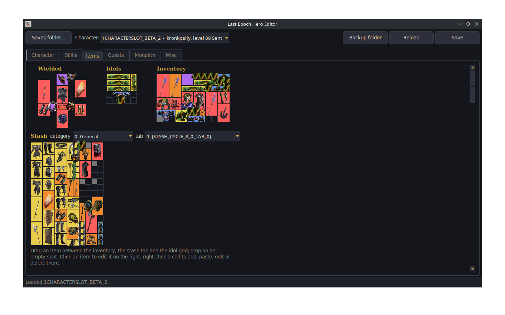
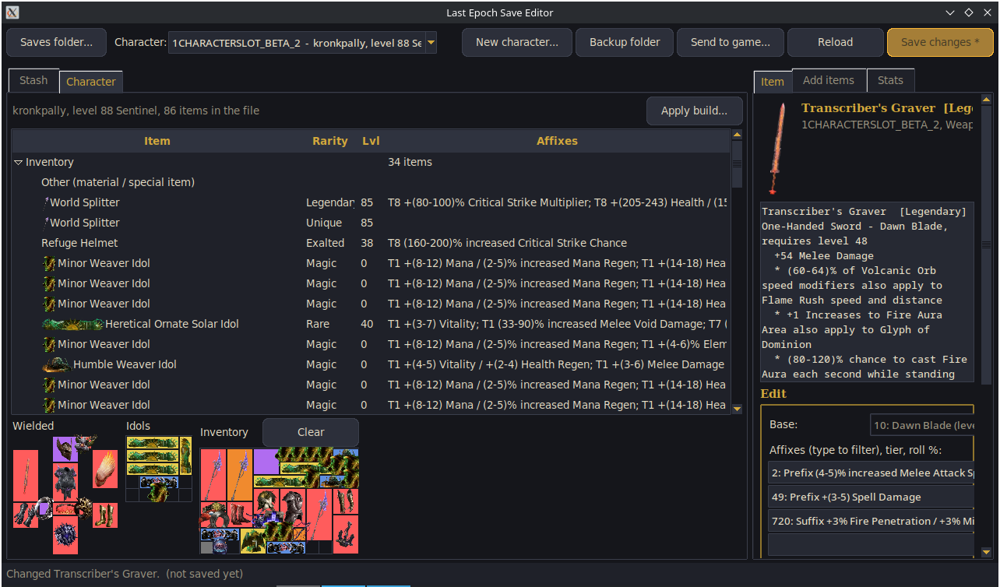
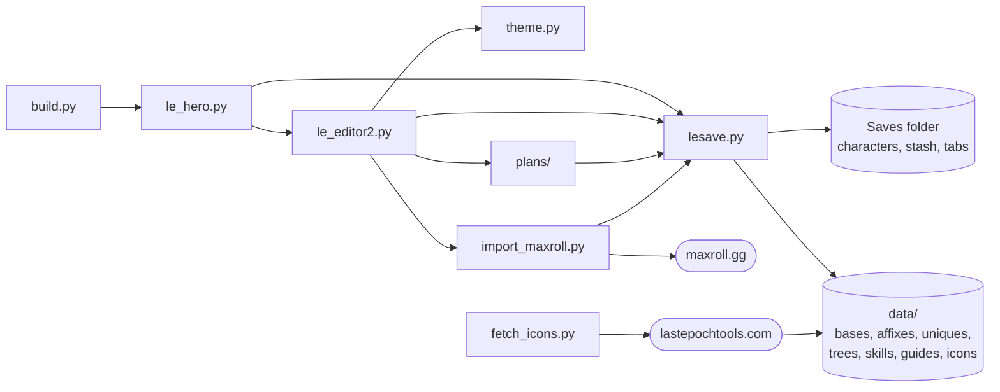

# Last Epoch Hero Editor

A desktop editor for **Last Epoch offline (single player) save files**, written in Python with Tkinter,
with no dependencies beyond the standard library. Built and tested on a Steam Deck; it runs on any
Linux or Windows machine with Python 3 and Tk and ships as a single file for Linux.

The main window follows the Diablo II Hero Editor idea: one character, everything about it in topic
tabs with fields you edit directly.



| Tab | What you edit |
|---|---|
| Character | name, class, mastery, level and experience, modes (Hardcore, Masochist, Solo Account / Character Found), stash gold, stats overview |
| Skills | passive nodes with + / - buttons and an unspent counter, specialized skills, their nodes and experience |
| Items | paper doll, idol grid, inventory and a stash tab (by category) side by side, drag and drop between them, right-click to spawn items at a cell, the item editor beside the grids |
| Quests | waypoint checklist by act, quest records, one-time events, copy campaign progress from another character |
| Monolith | timeline unlocks and completion, corruption, blessings per timeline |
| Misc | faction rank, reputation and favor, tutorial and UI flags |

A second window, the **browser layout**, keeps the stash-centred view (categories, tabs, items,
Maxroll build import, Apply build, New character, build plans, stats page); start it with `--browser`.



## Features

**Browse**
- The stash as categories, tabs and items, with the tab drawn as a grid; the character with a paper
  doll of the worn gear, the idol grid, the inventory grid, blessings and the other bags.
- Real item art, rarity colours and names as the game decides them (Magic, Rare, Exalted, Unique,
  Set, Legendary).

**Edit items**
- Base, up to four affixes with tier and roll, every implicit roll and every unique mod roll.
- Apply in place, add a copy, copy to the inventory or a stash tab, delete, max all rolls.
- Live preview of rarity and level requirement; any affix on any slot, tiers up to T8 and beyond,
  stacked affixes, legendaries that keep the unique's level requirement.

**Create items**
- Uniques with max rolls, custom items, leveling kits by level and weapon style, complete stash
  sets from scripted build plans.

**Maxroll builds**
- Import a guide page or a planner link: one stash tab per character preset with gear, idols,
  altar and blessings, plus a tab with every unique mentioned.
- Apply a preset to an existing character: passives, skill trees, ability bar, mastery, gear
  (worn, inventory, stash tab or skipped), idols, blessings.
- Create a new level 100 character from a preset with the campaign completed, monolith unlocked,
  in Normal, Solo Account Found or Solo Character Found mode, hardcore optional.

**Character stats overview**
- Resistances against the cap, attributes, health, mana, armour, endurance, crit, speed, damage,
  leech and skill levels summed from worn gear, idols, blessings, passives and the class base, each
  stat expandable to its sources.

**Safety**
- Every write goes to a timestamped backup folder first, new characters never overwrite a slot,
  the editor refuses to write while the game runs, and the Save button glows while changes are
  unsaved.

## Documentation

The [docs](docs/README.md) folder walks through the save system and the editor:

| Page | Contents |
|---|---|
| [docs/README.md](docs/README.md) | Index, dependency graph, how a character's state is decided |
| [docs/save-files.md](docs/save-files.md) | The Saves folder, file naming, the `EPOCH` + JSON format, backups |
| [docs/character.md](docs/character.md) | The character file field by field: identity, level, trees, containers, quests, progress, blessings, factions |
| [docs/items.md](docs/items.md) | The item byte array, rarity, affixes and tiers, rolls, uniques, level requirement, idols, altars |
| [docs/stash.md](docs/stash.md) | The stash file, categories, tab files, gold and materials |
| [docs/builds.md](docs/builds.md) | Maxroll import, guide JSON, tree data, character creation and applying presets |
| [docs/architecture.md](docs/architecture.md) | Modules, data files, safety model, packaging |



## Running

```
python3 le_hero.py                    # the Hero Editor, on the game's Saves folder when it finds it
python3 le_hero.py <saves folder>     # any folder with save files
python3 le_editor2.py                 # the browser layout
python3 build.py --install            # dist/LE_Hero_Editor.pyz plus desktop launchers (Linux)
python3 build.py --binary             # PyInstaller one-file binary (PyInstaller in a venv)
dist/LE_Hero_Editor.pyz --browser     # the packaged build with the browser layout
```

The game's Saves folder is found automatically on Steam Deck / Proton (`compatdata/899770`) and on
Windows (`AppData/LocalLow/Eleventh Hour Games/Last Epoch/Saves`). Close Last Epoch before saving.

Item pictures are not in the repository: run `python3 fetch_icons.py` once (needs Pillow, or `--tk`
for a Pillow-free run) to cut them from the lastepochtools.com sprite sheet into `data/icons/`.

## Command line

```
python3 lesave.py show <save file>              # list the items in a character or stash tab
python3 lesave.py kit <character> --level 40    # add a leveling gear set
python3 lesave.py backup                        # back up the game folder
python3 import_maxroll.py <maxroll guide or planner URL>
python3 plans/void_knight_endgame.py --write    # a scripted stash set
```

## Tested in game

On a Steam Deck with game version 1.5, cycle 8: edited and created items of every rarity, stash
categories and tabs, legendaries with four T8 affixes on any slot, created level 100 characters
from Maxroll presets (passives, skills, gear and campaign state accepted). Idol altars made by the
editor lack the game's corrupted affix and are untested. Keep the backups.

## Credits and disclaimer

Game data (bases, affixes, uniques, passive and skill trees) comes from the open-source
[LastEpochPlanner](https://github.com/Musholic/LastEpochPlanner) project; item art is cut at run time
from lastepochtools.com. Last Epoch is a trademark of Eleventh Hour Games; this project is not
affiliated with them. For offline characters only, at your own risk. MIT licence.
