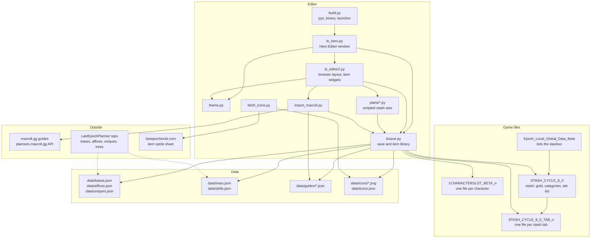
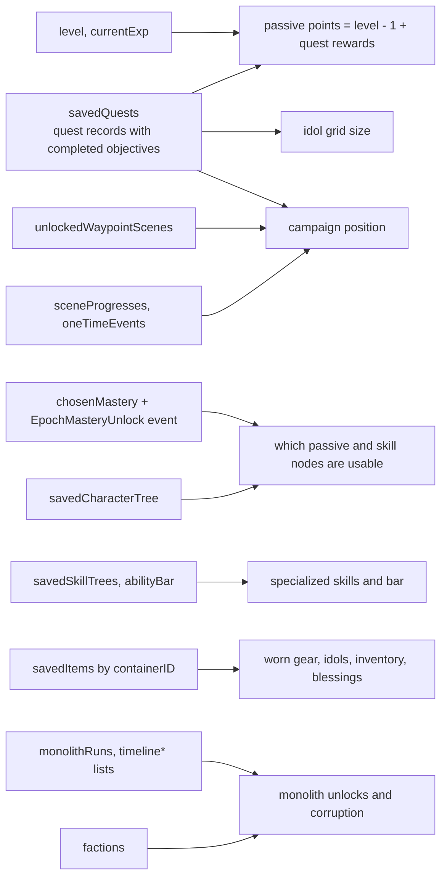

# Documentation

A walk through Last Epoch's offline save system as this editor understands it, and through the
editor itself. Everything here was read from real save files of a Steam Deck installation (game
version 1.5, cycle 8); field names are quoted as they appear in the files.

| Page | Contents |
|---|---|
| [save-files.md](save-files.md) | The Saves folder, file naming, the `EPOCH` + JSON format, backups and Steam Cloud |
| [character.md](character.md) | A character file: identity, level, masteries, passive and skill trees, item containers, quests, campaign and monolith progress, blessings, factions, flags |
| [items.md](items.md) | The item byte array: bases, rarity, affixes, tiers, rolls, uniques, legendaries, level requirement, idols, altars, blessings |
| [stash.md](stash.md) | The stash file, categories, tab files, gold and materials |
| [builds.md](builds.md) | Maxroll guide and planner import, the guide JSON, tree data, creating characters and applying presets |
| [architecture.md](architecture.md) | The editor's modules, data files, build and packaging |

## How the pieces depend on each other

Solid arrows are code reading or writing something; dotted arrows are where the data was taken
from once and converted.

## How a character's state is decided

The game does not keep one "progress" number. What you see in the character list and in game is
the sum of several independent records in the character file:

Each of these is described field by field in [character.md](character.md).
